<p align="center">
  
</p>

<p align="center">
  Practical workflows for coding agents. Built around measured results and explicit change budgets.
</p>

<p align="center">
  <a href="https://github.com/puneet-chandna/agent-skills/actions/workflows/validate.yml"></a>
  <a href="LICENSE"></a>
  <a href="https://skills.sh/puneet-chandna/agent-skills"></a>
</p>

<p align="center">
  <a href="#install">Install</a> · <a href="#choose-your-change-budget">Modes</a> · <a href="#what-the-agent-does">Workflow</a> · <a href="#read-the-evidence">Evidence</a>
</p>

## Optimize Server Performance

A repeatable workflow for profiling bottlenecks, improving implementations, and verifying the result. Covers backend services, algorithms, databases, networking, CPU and memory.

The main skill stays short. Detailed techniques, experiments and failure cases live in references the agent opens when relevant.

The challenge case studies primarily cover SQLite-backed services; the workflow also applies to other stacks using their own profiling and validation tools.

## Install

Run inside the project where you want to use it:

```bash
npx skills add puneet-chandna/agent-skills --skill optimize-server-performance
```

Select your agent when prompted. To choose Codex and Claude Code explicitly:

```bash
npx skills add puneet-chandna/agent-skills \
  --skill optimize-server-performance -a codex -a claude-code
```

Add `-g` to install for your user across projects. The [installer](https://github.com/vercel-labs/skills) supports additional agents and currently requires Node.js 22.20+. Python 3 is needed only for the included k6 summary checker; your project's own tools handle profiling and tests.

In Codex:

```text
Use $optimize-server-performance mode 2 on this project.
```

In other agents, ask them to use `optimize-server-performance` with your chosen mode. Host-specific invocation can differ.

## Choose your change budget

| Mode | What can change | What stays intact |
| :--- | :--- | :--- |
| **1 · Tune** | Remove redundant work, reduce copies, reuse resources, tune existing queries and pools | Algorithms, architecture and stack |
| **2 · Optimize** | Algorithms, data structures, memory layout, application pipelines and batching | Language, framework, database schema/engine and core transport/runtime |
| **3 · Rebuild** | Any necessary layer: libraries, transport, storage, native code, language or architecture | Required behavior, security and durability; stricter acceptance tests |

**Defaults to Tune. No silent escalation.** A higher mode permits deeper changes; it does not require a rewrite. [Exact boundaries and validation →](skills/optimize-server-performance/references/modes.md)

## What the agent does

1. **Profile** the workload and identify the limiting resource.
2. **Compare and implement** one justified change within the selected mode.
3. **Verify** correctness, per-route errors, throughput, tail latency and memory.
4. **Record** wins, rejected experiments and rollback in the project's performance journal.

Performance claims require at least three interleaved baseline/candidate pairs; Rebuild requires five. Sustained, soak and fault tests follow the changed behavior. Stateless algorithms use representative repeated samples. [Measurement protocol →](skills/optimize-server-performance/references/measurement.md)

## Read the evidence

The workflow draws on [The $12 Server Challenge](https://github.com/arjaythedev/twelve-dollar-server-challenge), alongside primary documentation and workload-specific experiments.

| Reference | What you get |
| :--- | :--- |
| [Case studies](skills/optimize-server-performance/references/case-studies.md) | Lean, the highest-scoring Rust entry in the snapshot, assembly, C, Mojo, F# and Cider: reasoning, outcomes and tradeoffs |
| [18 techniques](skills/optimize-server-performance/references/technique-catalog.md) | Where a technique helps, when it can lose, evidence, mode boundaries and verification |
| [Optimization playbook](skills/optimize-server-performance/references/optimization-playbook.md) | Bottleneck-specific experiments for queries, writes, allocations and connections |
| [Research snapshot](skills/optimize-server-performance/references/challenge-research.md) | Rules, recent submissions and provenance; checked 1 November 2026, with the upstream revision pinned |

Official scores, local measurements and projections stay separate. Installation alone changes no application code; the agent applies the workflow when invoked.

## Example

The [stdlib HTTP/SQLite fixture](examples/slow-api/README.md) includes a [results table](examples/slow-api/RESULTS.md) and [provenance manifest](examples/slow-api/evidence.json). No speedup is accepted. Raw evidence is archived locally and remains unpublished. This synthetic example does not predict gains elsewhere.

[Agent evaluation instructions](evals/README.md) prepare isolated no-skill/current/revised comparisons. These evaluations have not run; behavioral improvement remains unmeasured.

## Maintain and contribute

```bash
npx skills update optimize-server-performance
python3 -m unittest discover -s tests -v
```

Corrections and new techniques are welcome. Include a source or reproducible experiment, workload and hardware, before/after results, and a limitation. Keep detailed evidence in references and the main workflow concise.

MIT © [Puneet Chandna](https://github.com/puneet-chandna). Challenge-derived material retains its [upstream notice](skills/optimize-server-performance/references/upstream-license.txt). Independent project; not affiliated with OpenAI, Anthropic, Vercel or the challenge organizer.
